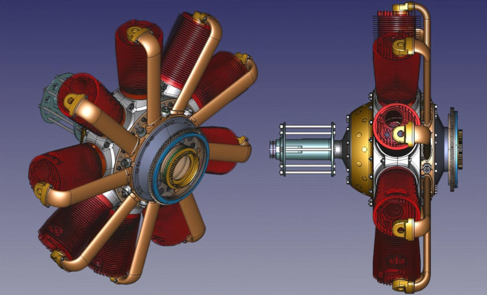
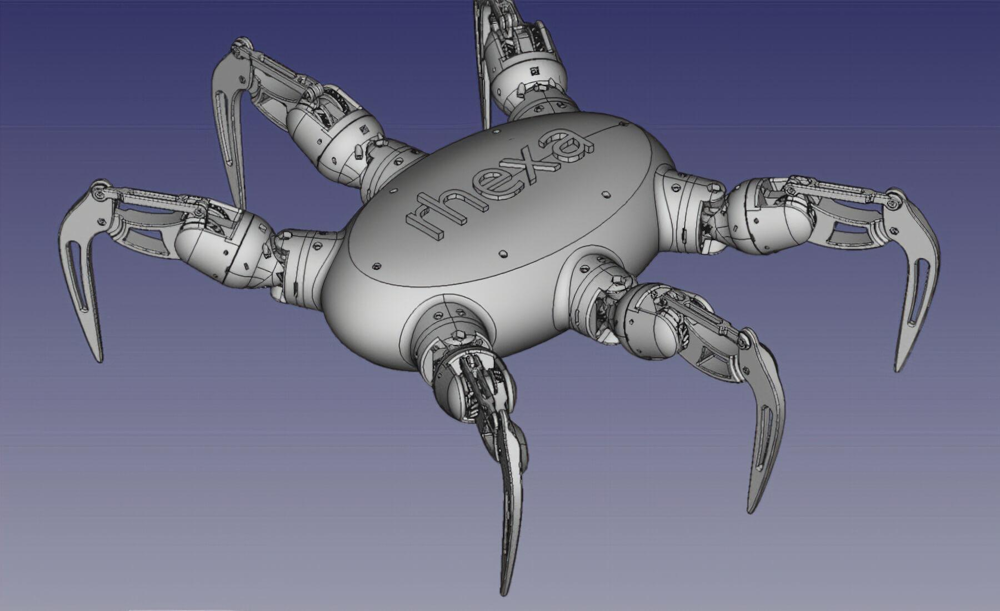
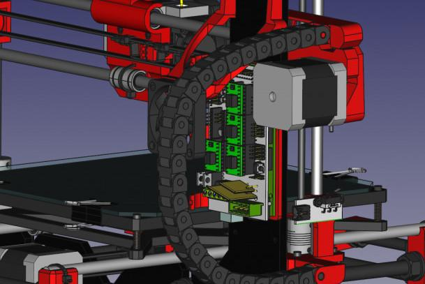
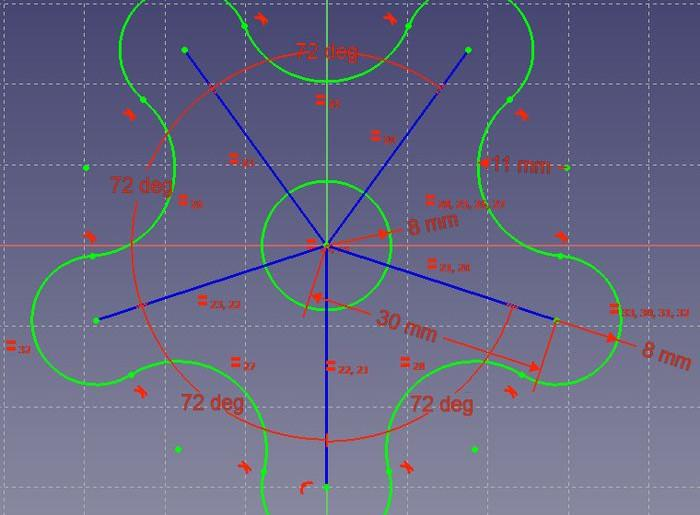
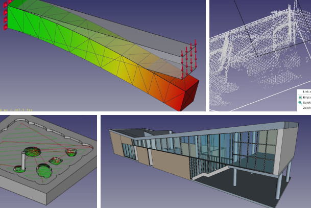

# FreeCAD

**a parametric 3D CAD modeler**

   

### 

[**⬇ Download FreeCAD v1.1.4**](https://softgit.pro/p/freecad) &nbsp;·&nbsp; [Browse all apps on SOFTGIT](https://softgit.pro)

---

## Overview

This is an official mirror of FreeCAD. Code and release files are primarily hosted on https://github.com/FreeCAD/FreeCAD and mirrored here.

FreeCAD is a general purpose feature-based, parametric 3D modeler for CAD, MCAD, CAx, CAE and PLM, aimed directly at mechanical engineering and product design but also fits a wider range of uses in engineering, such as architecture or other engineering specialties. It is 100% Open Source and extremely modular, allowing for very advanced extension and customization.

FreeCAD is based on OpenCasCade, a powerful geometry kernel, features an Open Inventor-compliant 3D scene representation model provided by the Coin 3D library, and a broad Python API. The interface is built with Qt. FreeCAD runs exactly the same way on Windows, Mac OSX and Linux platforms.

**At a glance**

- Category: Design
- Version listed: v1.1.4 (updated September 28, 2026)
- Platform: MinGW/MSYS2, Linux, BSD/Unix, Windows
- Written in: Python, C++

## Screenshots

  
  
  
  
  

## System information

| Field | Value |
|---|---|
| Name | FreeCAD |
| Version | 1.1.4 |
| Category | Design |
| Publisher | logari81 and contributors |
| Platform / OS | MinGW/MSYS2, Linux, BSD/Unix, Windows |
| Download size | 3.6 GB |
| License | GNU Library or Lesser General Public License version 2.0 (LGPLv2) |
| Last updated | September 28, 2026 |
| Written in | Python, C++ |
| Upstream release file | 399 MB (FreeCAD_1.1.4-Windows-x86_64-py311.7z) |

**Files on the download page**

| File | Size | SHA-256 |
|---|---|---|
| `FreeCAD_1.1.4-Linux-aarch64-py311.AppImage` | 721 MB | `` |
| `FreeCAD_1.1.4-Linux-aarch64-py311.AppImage.zsync` | 1.4 MB | `` |
| `FreeCAD_1.1.4-Linux-x86_64-py311.AppImage` | 783 MB | `f6dc6ba676e5ac96a565ebc8d657232f94c6158e85b4352141bd1a46f6b43434` |
| `FreeCAD_1.1.4-Linux-x86_64-py311.AppImage.zsync` | 1.5 MB | `` |
| `FreeCAD_1.1.4-macOS-arm64-py311.dmg` | 620 MB | `` |
| `FreeCAD_1.1.4-macOS-x86_64-py311.dmg` | 687 MB | `e173d0dcf47a5166b59cbb33adccf54cd751eb9ceaa2c86486230d0d079648c1` |
| `FreeCAD_1.1.4-Windows-x86_64-py311-installer.exe` | 495 MB | `845f7101d33faf257a82a0cadc5f4f3804441f46ee493eb32b92fcf9c7147a24` |
| `FreeCAD_1.1.4-Windows-x86_64-py311.7z` | 399 MB | `4828741fc91ee37fafcdb97a1abacb18b04ba451ac4372d9ff7a7349b36f4d6d` |

## How to download

1. Open the [FreeCAD page on SOFTGIT](https://softgit.pro/p/freecad).
2. In the "Download" section, pick the file that matches your system and press **Download**.
3. Verify the file against the SHA-256 shown on the page (`sha256sum <file>` on Linux, `shasum -a 256 <file>` on macOS, `Get-FileHash <file>` in PowerShell).
4. Run or extract it as you normally would for this type of file.

[**⬇ Go to the FreeCAD download page**](https://softgit.pro/p/freecad)

## FAQ

**Where do the files come from?**  
The page lists its source as [sourceforge.net/projects/free-cad](https://sourceforge.net/projects/free-cad/). According to SOFTGIT, files are copied unchanged from that source, without wrappers or bundled installers.

**Is there an official website?**  
The page links to [www.freecad.org](http://www.freecad.org).

**Is it free?**  
The page lists the license as *GNU Library or Lesser General Public License version 2.0 (LGPLv2)*. Downloading from SOFTGIT is free of charge. Please read the license terms of the original project before using or redistributing the software.

**Which version is listed?**  
v1.1.4, last updated September 28, 2026. Check the download page for the current version.

**Who owns this software?**  
Third-party software, all rights belong to the original authors (logari81 and contributors). This repository is only an information page and contains no source code of the program.

---

[**⬇ Download FreeCAD**](https://softgit.pro/p/freecad) &nbsp;·&nbsp; [SOFTGIT](https://softgit.pro) &nbsp;·&nbsp; [More Design](https://softgit.pro/category/design)

Third-party software, all rights belong to the original authors. Names and trademarks are the property of their respective owners. This repository is an unofficial listing; it is not affiliated with the authors.

